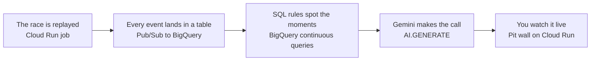

# Data Cloud: F1 Pit Wall with Real-Time Race Strategy

Replay a real Formula 1 race through Pub/Sub and watch BigQuery call the pit stops. Race events land in BigQuery as they arrive. Continuous queries spot a safety car, a pit stop or the start of rain within seconds. For each moment that matters, Gemini reads the state of the field and makes a strategy call, from a query in BigQuery.

There is no stream processor to run and no model to train. The rules are SQL, and the call is one `AI.GENERATE` function. Clone the repo, point it at your own GCP project, and run `tofu apply`.

- **A real race:** laps 30 to 50 of the 2025 Australian Grand Prix from the [OpenF1](https://openf1.org) historical API, with two safety cars and the return of the rain
- **Moments in seconds:** continuous queries flag safety cars, pit stops and rain 3 to 6 seconds after the event lands (verified on 2026-10-25)
- **A call per moment:** Gemini answers each safety car, rain start and gap closing with the cars that should box or stay out
- **A pit wall:** a private web app with a timing tower, the moments and the calls, and a **Start race** button

See [`docs/`](docs/README.md) for the step-by-step guide and [`docs/quick.md`](docs/quick.md) for copy-paste commands.

OpenF1 is an unofficial project and is not associated with the Formula 1 companies. This repo contains no F1 data: `tofu apply` downloads it into your project.

## Architecture

What happens when you press **Start race**:



How the pieces are connected, step by step: [`docs/architecture.md`](docs/architecture.md).

## Prerequisites

| Requirement | Notes |
| --- | --- |
| A GCP project with billing | Create it once, before the first apply. The commands are below. |
| [Google Cloud CLI](https://cloud.google.com/sdk/docs/install) | Provides `gcloud` and `bq`. Tofu calls both during the apply. |
| The `cloud-run-proxy` component | Opens the private pit wall. Install it with `gcloud components install cloud-run-proxy`, or the `google-cloud-cli-cloud-run-proxy` package where `gcloud` came from a package manager. Cloud Shell has it. |
| [OpenTofu](https://opentofu.org) 1.6 or later | `setup.sh` runs `tofu init`. |
| `python3` | The apply runs small Python scripts to download the race and deploy the saved queries and notebooks. |

The project ID must be globally unique. Create the project, then log in twice. Tofu uses the application default credentials. `bq`, `gcloud` and the scripts use the CLI login.

```bash
PROJECT_ID=<your-project-id>
gcloud projects create "$PROJECT_ID" --organization=<YOUR_ORG_ID>
gcloud billing projects link "$PROJECT_ID" --billing-account=<YOUR_BILLING_ACCOUNT>
gcloud auth login
gcloud auth application-default login
```

Set `project_id`'s default to your project ID. In `infra/variables.tf`, line 11, in the `project_id` variable:

```diff
-  default     = "datacloud-pitwall"
+  default     = "<your-project-id>"
```

Or make the same edit from the terminal:

```bash
perl -pi -e "s/default     = \"datacloud-pitwall\"/default     = \"$PROJECT_ID\"/" infra/variables.tf
```

That one value drives the providers, the resources, the bucket names and `setup.sh`.

## Quickstart

```bash
./infra/scripts/setup.sh   # one time per project: APIs, state bucket, pit wall viewer, tofu init
cd infra && tofu apply     # zero required variables
```

The apply downloads the race from OpenF1 into a bucket, builds three container images in Cloud Build, and waits for APIs, IAM and the reservation to propagate. `setup.sh` makes your `gcloud` account the only viewer of the pit wall.

## Verify

```bash
./scripts/verify.sh --expect READY   # every resource exists and is ready
./scripts/verify.sh --smoke          # a test moment gets a strategy call
```

The notebook **Verify** under **BigQuery Studio > Notebooks** runs the same checks.

## Try it

Follow [Race Strategy](docs/01-race-strategy.md). You start the race from the pit wall, read the rules that flag each moment, read Gemini's calls, and prove that no moment was missed.

## What gets created

Everything regional is in `us-central1`. BigQuery is in the `US` multi-region.

| Resource | Notes |
| --- | --- |
| Bucket `<project>-race-data` | The race, downloaded from OpenF1 during the apply |
| Topics `race-events`, `race-moments` | Every race event, and the moments the continuous queries flag |
| Topic `race-events-dead-letter` | Messages that BigQuery rejected 5 times |
| BigQuery subscriptions `race-events-bq`, `race-moments-bq` | Land the topics in `raw.raw_events` and `serving.moments` |
| `-demo` pull subscriptions | One per topic, so you can read the messages yourself. Nothing else reads them. |
| BigQuery datasets `raw`, `serving` | `raw_events`, and `moments` and `calls` |
| Reservation `continuous-queries` | Enterprise edition, no baseline, autoscaling to 50 slots, with a `CONTINUOUS` assignment |
| Cloud Run job `replayer` | Replays the race to `race-events` |
| Cloud Run services `strategist`, `pitwall` | The calls, and the web app. Neither allows public access. |
| BigQuery connection `vertex-ai-connection` | Lets `AI.GENERATE` call Gemini |
| Saved queries `00 Check: replays so far`, `02 Events: ...` and 7 more | Under **BigQuery Studio > Queries**, one per `queries/*.sql` |
| Notebooks `01 Race Strategy`, `Verify` | Under **BigQuery Studio > Notebooks**, one per `notebooks/*.ipynb` |
| Runtime template `F1 Pit Wall: Real-Time Race Strategy notebooks` | Colab Enterprise runtime for the notebooks, on the `notebooks` network with no public IP. It stops after 1 hour idle. |
| Artifact Registry repository `services` | The three container images |
| Bucket `<project>-build-staging` | Cloud Build's copy of the submitted source. Objects expire after 7 days. |
| Service accounts | `replayer`, `strategist`, `pitwall`, `cq-runner`, `moments-push`, `service-builder` |

## Known limitations

- During a live F1 session, OpenF1 refuses every request without an API key, past races included (verified on 2026-10-25). If the first apply stops with that message, run `tofu apply` again after the session. Once the race is in your bucket, the apply and the replay never call OpenF1 again.
- Several `TUMBLE` aggregations joined with `UNION ALL` in one continuous query emitted nothing (verified on 2026-10-25). The windowed query uses one aggregation.

## Cleanup

Press **Stop** on the pit wall first, or run the saved query **99 Stop: cancel the continuous queries**. Then:

```bash
cd infra && tofu destroy
```

These stay after `tofu destroy`:

| Left behind | Why | Remove with |
| --- | --- | --- |
| The project | Tofu did not create it | `gcloud projects delete "$PROJECT_ID"` |
| `gs://<project>-tfstate` | It holds the state that `destroy` uses | `gcloud storage rm -r "gs://$PROJECT_ID-tfstate"` |
| `infra/viewer.auto.tfvars` | `setup.sh` wrote it on your machine | `rm infra/viewer.auto.tfvars` |
| Enabled APIs | Tofu leaves them on so that a shared project does not break | `gcloud services disable`, if you want |

Deleting the project removes all of them.
