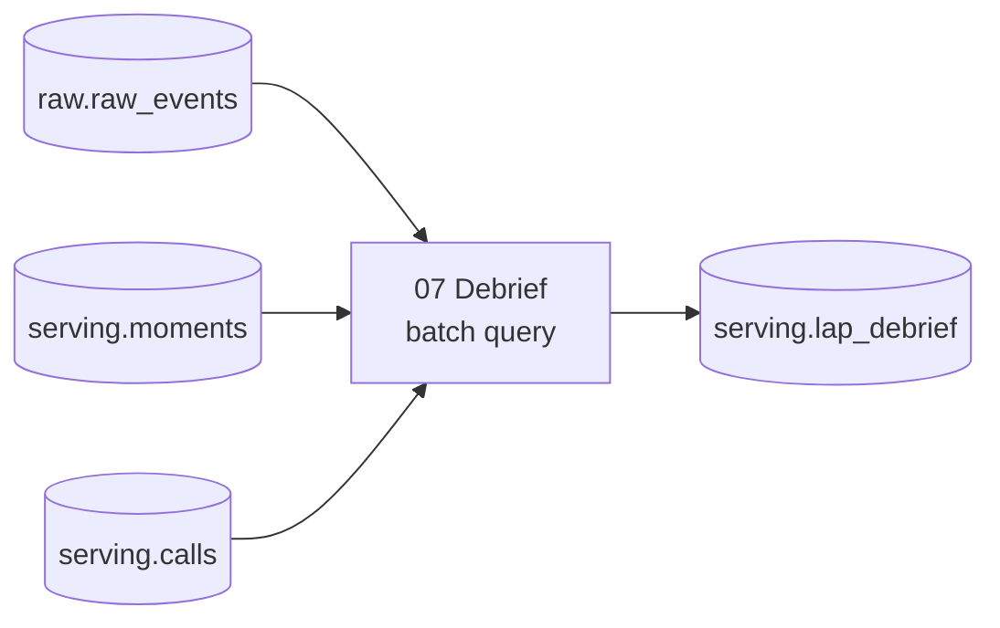

# Post-Race Debrief

The race is over. You turn the replay into a lap-by-lap debrief table, find it in Knowledge Catalog as part of a data product with its quality scores, profile, insights and lineage, and ask a Conversational Analytics agent about the race in plain English.

Do [Race Strategy](01-race-strategy.md) first, or at least have one finished replay. You can follow the same steps in Python: open **BigQuery Studio > Notebooks > 02 Debrief**.

Run all commands from the repository root, with `PROJECT_ID` set to your project:

```bash
PROJECT_ID=<your-project-id>
```

| Step | What you do | What you see |
| --- | --- | --- |
| 1 | Build the debrief | One row per car per lap, with typed columns instead of JSON |
| 2 | Find the data products | Race Telemetry and Race Strategy, each owned by a team |
| 3 | Read the quality scores | A pass or fail per rule, by dimension, for every replay |
| 4 | Read the profile, insights and glossary | Column statistics, suggested questions and business terms |
| 5 | Follow the lineage | `raw_events`, `moments` and `calls` flowing into `lap_debrief` |
| 6 | Ask the data agent | Answers in plain English, with the SQL behind them |

---

## Step 1: Build the debrief

`raw.raw_events` holds each OpenF1 record as a JSON `payload`. That suits the continuous queries, which read one event at a time. A debrief needs one row per car per lap, with the position, gaps, tyres and pit stop at the end of each lap.

Run the saved query **07 Debrief: every car, every lap** (`queries/07-debrief.sql`). It rebuilds `serving.lap_debrief` from all replays with one batch query, then shows the latest replay's top five. The apply ran it once, so run it again after each new replay.

```sql
-- The latest reading at or before the end of each lap.
positions AS (
  SELECT l.run_id, l.driver_number, l.lap, SAFE.INT64(e.payload.position) AS position
  FROM laps AS l
  JOIN ev AS e
    ON e.event_type = 'position' AND e.run_id = l.run_id
    AND e.driver_number = l.driver_number AND e.event_ts <= l.lap_end_ts
  QUALIFY ROW_NUMBER() OVER (PARTITION BY l.run_id, l.driver_number, l.lap ORDER BY e.event_ts DESC) = 1
),
```

| lap | position | driver | team | lap_s | compound | tyre_age_laps | pitted | raining | moments |
| --- | --- | --- | --- | --- | --- | --- | --- | --- | --- |
| 50 | 1 | NOR | McLaren | 142.395 | INTERMEDIATE | 6 | false | false | [] |
| 50 | 2 | VER | Red Bull Racing | 142.085 | INTERMEDIATE | 4 | false | false | [] |
| 50 | 3 | RUS | Mercedes | 142.305 | INTERMEDIATE | 6 | false | false | [] |
| ... | | | | | | | | | |
| 46 | 5 | VER | Red Bull Racing | 112.606 | INTERMEDIATE | 0 | true | true | [PIT_STOP] |

*Sample output from replay run-4dd1cc64 (2026-10-28), rebuilt on 2026-10-29. Each replay adds 823 rows.*

Each row also carries the moments flagged for that car on that lap and Gemini's call for it, joined through the moment's Pub/Sub message ID. Race-wide moments, such as a safety car, have no car, so they stay in `serving.moments` and `serving.calls`.

---

## Step 2: Find the data products

Open **Knowledge Catalog > Data products** in the console (`https://console.cloud.google.com/dataplex/data-products?project=<project>`), location `us`.

| Data product | Owner | Assets |
| --- | --- | --- |
| Race Telemetry | Trackside Engineering | `raw.raw_events`, `raw.car_photos` |
| Race Strategy | Race Strategy team | `serving.moments`, `serving.calls`, `serving.lap_debrief`, `serving.cars` |

A data product packages tables for the people who use them, with an owner and a description. Both products live in one project: the boundary is ownership, not projects. `infra/data_products.tf` defines them.

---

## Step 3: Read the quality scores

In BigQuery, open `serving.lap_debrief` and its **Data quality** tab. The apply ran one quality scan per table, and published each result to the catalog.

| Table | Rules passed | Score | Failed rule |
| --- | --- | --- | --- |
| `serving.calls` | 6 of 6 | 100 | |
| `serving.lap_debrief` | 7 of 7 | 100 | |
| `raw.raw_events` | 3 of 4 | 75 | `event-type-is-openf1`: 1 hand-published test event of 1.56 million |
| `serving.moments` | 2 of 4 | 50 | `moment-is-known`: 20 moments from a rule retired during development. `every-pit-stop-flagged`: a tuning replay whose continuous query stopped early. |

*Results from 2026-10-29 in the demo project, which still holds the replays from building the demo. In a new project, complete replays pass every rule.*

Each rule has a dimension: completeness, validity, uniqueness or consistency. `infra/data_scans.tf` lists them. Two are worth a look:

- `moments`, **every-pit-stop-flagged** (consistency): the saved query **05 Proof** as a rule, checked for every replay in the table instead of the latest one.
- `calls`, **every-call-answers-a-moment** (consistency): each call points at a moment that exists.

The scans run on demand. Run them again after a replay from the **Data quality** tab, or:

```bash
for scan in raw-events-quality moments-quality calls-quality lap-debrief-quality; do
  gcloud dataplex datascans run "$scan" --location=us-central1 --project="$PROJECT_ID"
done
```

If you add a moment, such as the red flag in [Race Strategy](01-race-strategy.md#add-a-red-flag-moment), add it to the `moment-is-known` rule too.

---

## Step 4: Read the profile, insights and glossary

On the same table:

- **Data profile**: null share, distinct values and ranges for each column, from the profile scan.
- **Insights**: a description of the table and suggested questions with their SQL, written by Gemini from the schema and the profile.
- **Schema**: hover `compound`, `tyre_age_laps` or `pit_lane_s` to see the glossary term that defines it. The glossary **Race strategy** has 11 terms (`infra/catalog_glossary.tf`).

On `serving.moments`, the **moment-rules** aspect records what each continuous query looks for and the lag observed. On `serving.calls` and `serving.cars`, the **model-description** aspect records the Gemini model, how it is called and its known limits (`infra/catalog_aspects.tf`).

---

## Step 5: Follow the lineage

Open `serving.lap_debrief` and its **Lineage** tab. The Data Lineage API records every BigQuery job from the moment it is enabled, so the run of **07 Debrief** during the apply drew the graph:



The run of **06 Cars** drew a second graph, from `raw.car_photos` to `serving.cars`. `serving.moments` and `serving.calls` have no upstream in the graph: a Pub/Sub subscription and the strategist's streaming inserts write them, not a query.

---

## Step 6: Ask the data agent

Open **BigQuery > Agents** and pick **Pit wall race engineer**. It reads the four serving tables, with a system instruction, a glossary and 7 verified queries (`infra/agent.tf`).

Try:

- *How many moments did the latest replay flag, by type?*
- *What did Gemini recommend when the rain started, and how long did the call take?*
- *Who pitted in the latest replay, on which lap, and onto which tyre?*
- *Which cars had the most closing-gap alerts, and what did Gemini tell them?*

Asked on 2026-10-29: *Did the drivers Gemini told to box when the rain started actually pit, and on which lap?* The agent joined `serving.calls` with `serving.lap_debrief` and answered that nine cars boxed on lap 44, when the rain began, and the five cars named in Gemini's call (VER, GAS, HAM, LEC, TSU) stayed out 2 to 3 laps longer, switching to intermediates on laps 46 and 47.

Each answer shows the SQL it ran. The verified queries pin how the agent answers the questions that matter, so its numbers match the saved queries.

---

## Key Takeaways

| Capability | Technology | Business value |
| --- | --- | --- |
| Turn JSON events into a typed table | One BigQuery batch query | Analysts query laps and tyres, not payloads |
| Package data by owner | Knowledge Catalog data products | Consumers find what a team publishes and who to ask |
| Check data with rules everyone can see | Knowledge Catalog data quality scans | A pass or fail per rule, by dimension, on the table itself |
| Explain a table without reading SQL | Profiles, insights, glossary and aspects | Column statistics, suggested questions and business terms in one place |
| See where a table comes from | Data Lineage | The sources of every table, recorded from the jobs themselves |
| Ask the data in plain English | Conversational Analytics data agent | Answers grounded in the tables, with the SQL shown |

---

## Navigation

[← Race Strategy](01-race-strategy.md) | [Overview](README.md) | [Quick Reference](quick.md) | [Architecture](architecture.md)
