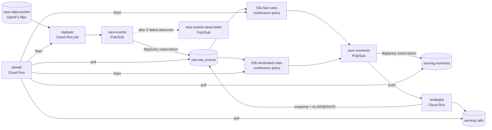
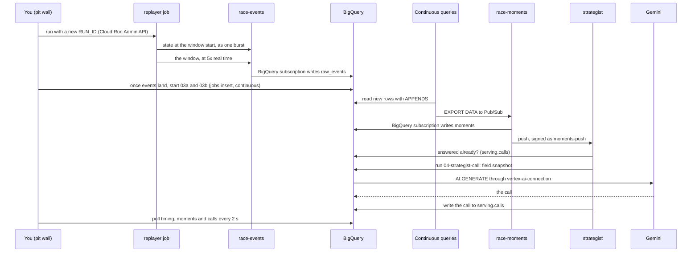

# F1 Pit Wall with Real-Time Race Strategy Architecture

How the replay, the continuous queries, the strategist and the pit wall fit together, the messages they exchange, and the product behaviour the code depends on.

Back to the [docs overview](README.md).

## Pipeline Overview

What gets built, and how it is connected.



## Data Flow

In what order things happen after you press **Start race**, and which calls are made.



## Key Components

| Component | Object | Purpose |
| --- | --- | --- |
| Loader | `infra/scripts/load_race_data.py` | Downloads the race from OpenF1 during the apply, on the machine that runs it |
| Replayer | `services/replayer/`, Cloud Run job `replayer` | Publishes the window to `race-events` at `replay_speed`, with a `run_id` |
| Fast rules | `queries/03a-moments-fast.sql` | `SAFETY_CAR`, `PIT_STOP` and `RAIN_STARTED` from one event |
| Windowed rules | `queries/03b-moments-windowed.sql` | `GAP_CLOSING` from a `TUMBLE` window per car |
| Strategist | `services/strategist/`, Cloud Run service `strategist` | Runs `queries/04-strategist-call.sql` for each safety car, rain start and gap closing |
| Pit wall | `services/pitwall/`, Cloud Run service `pitwall` | Starts a replay and its continuous queries, and shows timing, moments and calls |
| Capacity | Reservation `continuous-queries` | Enterprise edition, no baseline, autoscaling to 50 slots, `CONTINUOUS` assignment |

The rendered queries in `queries/` are the single source of SQL. The apply deploys them as saved queries, and passes the same text to the pit wall and the strategist.

## Race event message

The replayer publishes one message per OpenF1 record to `race-events`. The BigQuery subscription maps the fields to the columns of `raw.raw_events` by name.

| Field | Type | Meaning |
| --- | --- | --- |
| `run_id` | string | The replay |
| `event_type` | string | The OpenF1 stream: `car_data`, `intervals`, `laps`, `position`, `race_control`, `weather`, `pit`, `overtakes`, `stints`, `drivers` |
| `event_ts` | timestamp | Race time when the record became known |
| `session_key` | integer | The OpenF1 session |
| `driver_number` | integer | The car, empty for race-wide records |
| `payload` | JSON string | The OpenF1 record. Weather records also carry `previous_rainfall`, which the replayer adds. |

The safety car on lap 34, as a row in `raw.raw_events`:

```json
{
  "run_id": "run-184b04fc",
  "event_type": "race_control",
  "event_ts": "2025-03-16 05:15:09",
  "session_key": 9693,
  "driver_number": null,
  "payload": {"category": "SafetyCar", "date": "2025-03-16T05:15:09+00:00", "driver_number": null,
              "flag": null, "lap_number": 34, "meeting_key": 1254, "message": "SAFETY CAR DEPLOYED",
              "qualifying_phase": null, "scope": null, "sector": null, "session_key": 9693},
  "publish_time": "2026-10-25 22:58:59"
}
```

## Moment message

The continuous queries publish one message per moment to `race-moments`.

| Field | Type | Meaning |
| --- | --- | --- |
| `run_id` | string | The replay |
| `moment` | string | `SAFETY_CAR`, `PIT_STOP`, `RAIN_STARTED` or `GAP_CLOSING` |
| `driver_number` | integer | The car, empty for race-wide moments |
| `lap` | integer | The race lap, when the event carries it |
| `event_ts` | timestamp | Race time of the event that triggered the moment |
| `detail` | string | What the rule saw |

The same safety car, 4 seconds later, as a message on `race-moments`:

```json
{"run_id": "run-184b04fc", "moment": "SAFETY_CAR", "driver_number": null, "lap": 34,
 "event_ts": "2025-03-16T05:15:09Z", "detail": "SAFETY CAR DEPLOYED"}
```

A gap closing from the windowed rules:

```json
{"run_id": "run-184b04fc", "moment": "GAP_CLOSING", "driver_number": 23, "lap": null,
 "event_ts": "2025-03-16T05:17:39Z", "detail": "gap to car ahead 1.617 s -> 0.593 s"}
```

## Observed behaviour

| Behaviour | Published docs | Observed | Verified on |
| --- | --- | --- | --- |
| Continuous query start time | `APPENDS` processes data from the start timestamp | A start time 1 minute back failed with "Invalid timestamp bounds" while events were landing. 10 minutes back works. | 2026-10-25 |
| Continuous query on an idle table | Not stated | Fails with "Invalid timestamp bounds" | 2026-10-25 |
| Several `TUMBLE` aggregations with `UNION ALL` | Stateful operations are supported (Preview) | Emitted nothing. One `TUMBLE` aggregation emits to Pub/Sub and to a table. | 2026-10-25 |
| `TUMBLE` window boundaries | Windows close on `_CHANGE_TIMESTAMP` | A change between two readings is missed when they fall on either side of a boundary | 2026-10-25 |
| Fast rules: event to moment | Not stated | 3 to 6 seconds, up to 23 seconds when 14 pit stops land within a minute | 2026-10-25 |
| Windowed rules: event to moment | Results only when a window closes | 40 to 70 seconds, in batches about once a minute | 2026-10-25 |
| `EXPORT DATA` to Pub/Sub identity | Requires a service account | A user account is rejected | 2026-10-25 |
| New `CONTINUOUS` assignment | Not stated | About 1 minute before a query accepts it | 2026-10-25 |
| BigQuery subscription and `JSON` columns | Not stated | A nested object is rejected and retried. A JSON string lands. | 2026-10-25 |
| `AI.GENERATE` `model_params` | Matches the `GenerateContent` request body | `"thinkingLevel": "low"` is rejected, `"LOW"` works | 2026-10-25 |
| `gemini-2.5-flash` | | No longer served for a new project | 2026-10-25 |
| OpenF1 during a live F1 session | Real-time data needs a paid key | Historical requests also return 401 | 2026-10-25 |
| Replayer start | | 20 seconds to 2.5 minutes from run to first event | 2026-10-25 |

## Navigation

[← Overview](README.md) | [Race Strategy](01-race-strategy.md) | [Quick Reference](quick.md)
